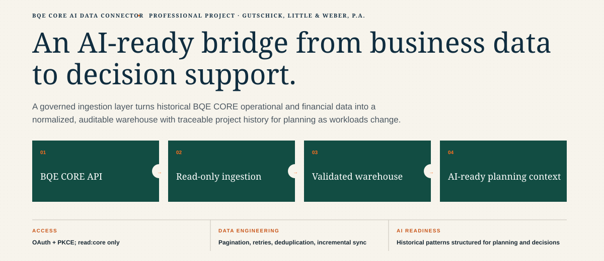

# BQE CORE AI Data Connector

**Professional project · Gutschick, Little & Weber, P.A.**



## An AI-ready bridge from business data to decision support

This connector turns authorized historical BQE CORE operational and financial data
into a normalized, auditable local warehouse. It gives downstream AI tools traceable
project and resource history for human-reviewed workload planning as schedules change.

BQE CORE remains the system of record. The connector cannot create, update, or delete
BQE data.

## What it does

1. **BQE CORE API** — authorizes a Native App through OAuth Authorization Code with
   PKCE and requests exactly `read:core`.
2. **Read-only ingestion** — performs GET requests only, follows pagination, retries
   transient failures, honors rate limits, and advances per-resource checkpoints.
3. **Validated warehouse** — retains deduplicated raw response batches and normalizes
   authorized data into SQLite with sync-run history and integrity checks.
4. **AI-assisted planning** — exports traceable JSON, Markdown, and CSV summaries of
   project history, employee workload, allocations, and trends.

### Production capabilities

- GET-only API client; write methods are blocked before network I/O.
- Native App PKCE authorization with state validation and a loopback callback.
- Short-lived access-token storage in Windows Credential Manager.
- Double opt-in for live access through `BQE_MODE=LIVE` and `BQE_ENABLE_LIVE=YES`.
- Permission-aware sync: unavailable resources are recorded and skipped by default.
- Full first load or bounded date-window load, followed by incremental synchronization.
- Page-level raw audit evidence, SHA-256 deduplication, normalized upserts, and
  per-resource high-water marks.
- Retry handling for rate limits, server errors, timeouts, and temporary network errors.
- SQLite integrity, foreign-key, audit-coverage, and negative-time checks.
- Planning context that carries source metadata, coverage, checkpoints, validation
  results, safety limits, employee history, project history, and monthly trends.
- Mock data and automated tests for a safe, repeatable demonstration.

## Supported resources

The sync engine supports clients, employees, projects, time entries, expense entries,
invoices, payments, and allocations. Actual availability depends on the BQE subscription
and security permissions of the person who authorizes the app. If project or employee
master endpoints are unavailable, names returned with authorized time and expense facts
still support historical summaries.

## Quick start

Python 3.11 or later is required.

```powershell
py -3.11 -m venv .venv
.venv\Scripts\python.exe -m pip install --upgrade pip
.venv\Scripts\python.exe -m pip install -e ".[dev]"
```

Run the synthetic end-to-end workflow without a BQE connection:

```powershell
$env:BQE_MODE="MOCK"
$env:BQE_ENABLE_LIVE="NO"
.venv\Scripts\bqe.exe sync
.venv\Scripts\bqe.exe validate
.venv\Scripts\bqe.exe analyze
.venv\Scripts\bqe.exe brief
.venv\Scripts\bqe.exe export-context
.venv\Scripts\python.exe -m pytest
```

Local databases and generated exports are Git-ignored. Safe synthetic examples are
checked in under `examples/outputs/`.

## Configure authorized read-only access

Create a **Native App** in the BQE Developer Portal:

- Redirect URI: `http://127.0.0.1:8765/callback`
- Scope: `read:core` only
- No client secret
- No webhook
- No `offline_access` or `readwrite:core`

Copy `.env.example` to `.env`, enter the displayed client ID, and keep the two live
gates disabled while reviewing the configuration.

```powershell
Copy-Item .env.example .env
notepad .env
.venv\Scripts\bqe.exe auth --login
.venv\Scripts\bqe.exe test-access --live timeentry expenseentry allocation
```

After explicit approval, set `BQE_MODE=LIVE` and `BQE_ENABLE_LIVE=YES`.

For a bounded first load:

```powershell
.venv\Scripts\bqe.exe sync --live `
  --resources time_entries expense_entries allocations `
  --from 2026-01-01 --to 2026-07-31
```

For an intentionally complete first load:

```powershell
.venv\Scripts\bqe.exe sync --live --full
```

Later runs use stored checkpoints:

```powershell
.venv\Scripts\bqe.exe sync --live
.venv\Scripts\bqe.exe status
.venv\Scripts\bqe.exe validate
.venv\Scripts\bqe.exe export-context
```

`--strict` makes inaccessible resources fail the run. Without it, they are recorded as
unavailable and the remaining authorized resources continue.

## Command reference

| Command | Purpose |
|---|---|
| `bqe auth --login` | Interactive PKCE authorization |
| `bqe auth --clear` | Delete the locally stored access token |
| `bqe test-access --live …` | Five-row, field-minimized capability probes |
| `bqe sync` | Load synthetic fixtures |
| `bqe sync --live` | Incrementally ingest authorized BQE resources |
| `bqe status` | Show local row counts, checkpoints, and recent sync runs |
| `bqe validate` | Check warehouse integrity and audit coverage |
| `bqe analyze` | Export project, employee, and monthly CSV summaries |
| `bqe brief` | Export a human-readable management brief |
| `bqe export-context` | Export traceable JSON and Markdown for AI planning |
| `bqe inspect-schema` | Print the local SQLite schema |

## Security and governance

- No credentials, tokens, company databases, caches, logs, or generated live exports
  belong in Git.
- The public repository contains synthetic examples only.
- Access is bounded by the authorizing user's BQE subscription and permissions.
- Authorization is interactive because Native Apps do not use a refresh token here.
- Live synchronization is disabled by default and requires two local settings.
- Financial summaries must be reconciled to BQE reports before presentation.
- AI output is decision support for people; it is not an autonomous schedule or a write
  path back to BQE.

See [SECURITY.md](SECURITY.md), the
[live authorization runbook](docs/LIVE_AUTH_RUNBOOK.md), the
[analytical model](docs/LOCAL_ANALYTICAL_MODEL.md), and the
[API capability assessment](docs/BQE_API_CAPABILITY_ASSESSMENT.md).

## Known boundaries

BQE does not expose every CORE web module through the public API. This connector can
only retrieve data available to the authorizing user. Future availability, approved
leave, and proposed work still require a maintained planning input if those records are
not available through an authorized endpoint. Historical patterns help people review
capacity and conflicts; they do not replace current commitments or management judgment.

This is an independent integration and is not affiliated with or endorsed by BQE
Software.
